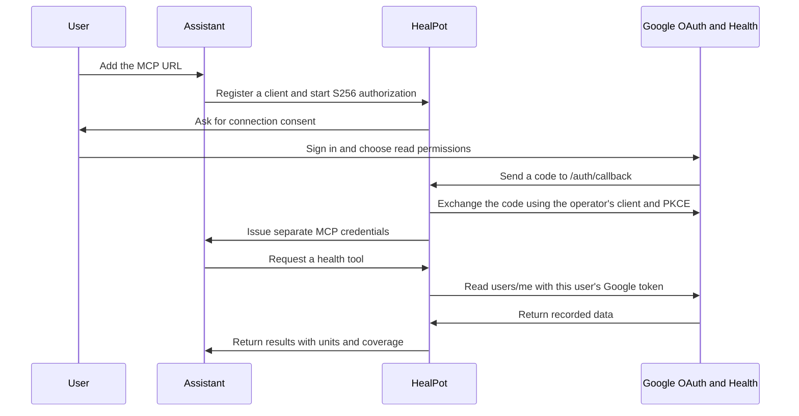

# Deployment

HealPot runs independently with its own process, port, dependencies and OAuth storage. It needs no dashboard, native app or separate database service. Start with [self-hosting](self-hosting.md).

## Authorization

FastMCP's [Google provider](https://gofastmcp.com/integrations/google) and [OAuth proxy](https://gofastmcp.com/servers/auth/oauth-proxy) connect MCP clients to the operator's Web OAuth client. The proxy checks Google identity, scopes, expiry and client audience. It stores Google credentials encrypted and issues separate MCP reference tokens. Raw Google tokens cannot authenticate MCP requests.

The server requires `openid`. Health scopes are optional during sign-in, and each tool checks the granted categories. Without a health scope, tools return `missing_permission` without calling Google. The server requests no write, location, email or profile permission. See the [scope list](self-hosting.md#google-cloud-setup) and [Google's scope guide](https://developers.google.com/health/scopes).

Register the server's `/auth/callback` URL in Google. Keep any callbacks that other applications still use. Offline access and explicit consent allow token refresh. See [Google setup](https://developers.google.com/health/setup) and [web-server OAuth](https://developers.google.com/identity/protocols/oauth2/web-server).

Health requests always use the authenticated user's `users/me` path. `get_connection_status` checks [Health identity](https://developers.google.com/health/reference/rest/v4/users/getIdentity). Google sign-in alone does not prove that the account is linked to Google Health.

## Configuration

| Variable | Purpose |
| --- | --- |
| `GOOGLE_HEALTH_MCP_GOOGLE_CLIENT_ID` | Google Web OAuth client ID |
| `GOOGLE_HEALTH_MCP_GOOGLE_CLIENT_SECRET` | Google client secret |
| `GOOGLE_HEALTH_MCP_STORAGE_ENCRYPTION_KEY` | Fernet key for OAuth storage |
| `GOOGLE_HEALTH_MCP_TOKEN_SIGNING_KEY` | Stable signing key with at least 32 random characters |
| `GOOGLE_HEALTH_MCP_PUBLIC_BASE_URL` | Public HTTPS origin with no path |
| `GOOGLE_HEALTH_MCP_PRIVACY_POLICY_URL` | HTTPS privacy policy linked during consent |
| `GOOGLE_HEALTH_MCP_HOST` | Bind address, set to `0.0.0.0` in Docker |
| `GOOGLE_HEALTH_MCP_PORT` | Host port, default `8001` |
| `GOOGLE_HEALTH_MCP_DATA_DIR` | OAuth storage directory, `/data/oauth` in Docker |
| `GOOGLE_HEALTH_MCP_ALLOWED_CLIENT_REDIRECT_URIS` | JSON list of allowed assistant callback patterns |

HTTP is allowed only for loopback development. The default callback list permits loopback clients and HTTPS callbacks on `claude.ai`, `chatgpt.com`, `grok.com` and `muse.ai`. Check each client's actual callback and narrow the list for your deployment. Add other fixed hosts as needed. Universal host wildcards are rejected.

Connection consent binds the Google callback to the approving browser. Host and Origin checks protect HTTP requests. MCP tokens are bound to this server's resource audience. The proxy does not forward MCP's `resource` parameter to Google.

## HTTPS

Follow [public HTTPS setup](self-hosting.md#public-https). Route the whole domain to the MCP service so discovery, consent, callbacks and token requests work. Forward the public Host header and disable URL, query and body logging.

The optional Caddy proxy uses ports 80 and 443. If another proxy already owns those ports, use a separate virtual host on that proxy. `/healthz` checks readiness without contacting Google.

## Storage and upgrades

Fernet encrypts Google credentials, client registrations, OAuth transactions, codes and token mappings in the persistent disk store. The private directory uses permissions `0700`. Protect disk metadata, traffic metadata and backups through host access controls.

The server reads health records on demand and stores no health history or shared result cache. Your chosen assistant receives the requested results and applies its own processing and retention policies.

MCP access tokens normally follow Google's access-token lifetime. Refresh references have a fallback maximum lifetime of 30 days. Google expiry or revocation still takes effect. Testing-mode Google refresh tokens may expire sooner. MCP refresh tokens rotate, and renewed Google credentials stay on the server.

Keep `.env`, both keys and the OAuth volume private. Back up the keys and volume together in encrypted storage. Losing or replacing them requires users to reconnect. Delete individual users' references through your operator process. Deleting the whole volume disconnects everyone. See [disconnect](privacy.md#disconnect).

## Public operation

Before accepting other users:

- Publish your operator policy and consent disclosure.
- Provide a per-user deletion process and define backup retention.
- Add rate limits and abuse protection to authorization and registration endpoints.
- Complete Google's OAuth verification and any required security assessment.

Use one application process on one host. Multiple workers or hosts need shared transactional OAuth storage and concurrency testing. Passing local tests does not establish Google approval or a working connection with an external assistant.
